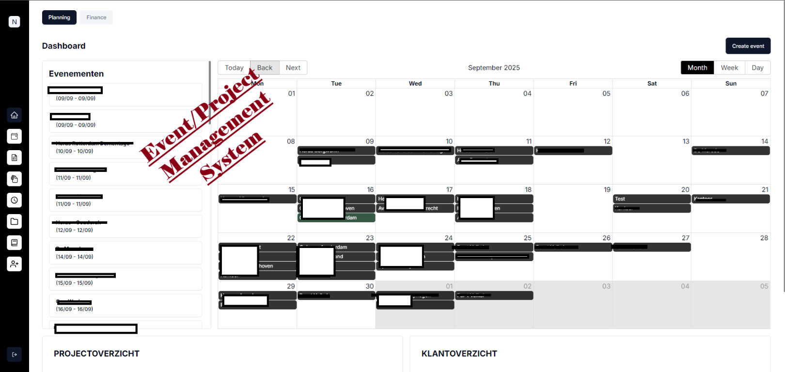
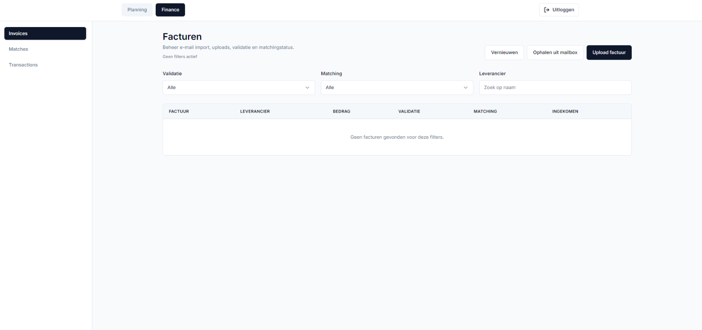
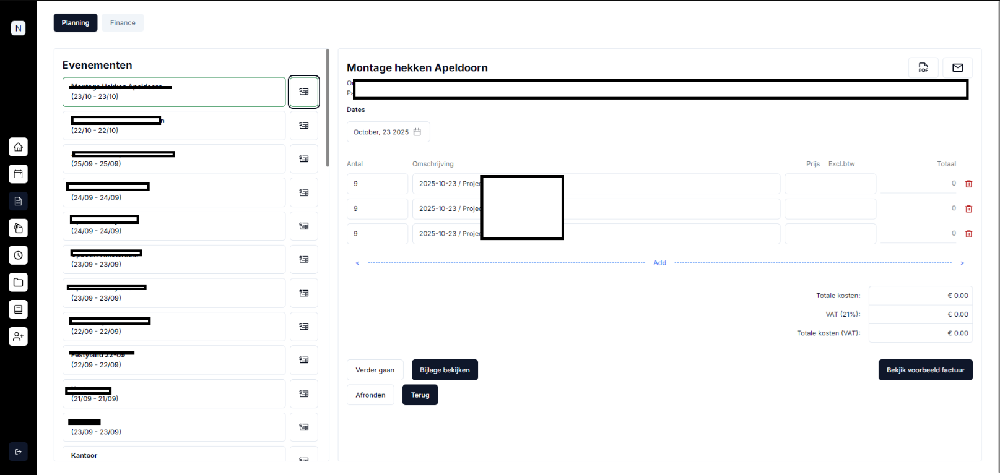
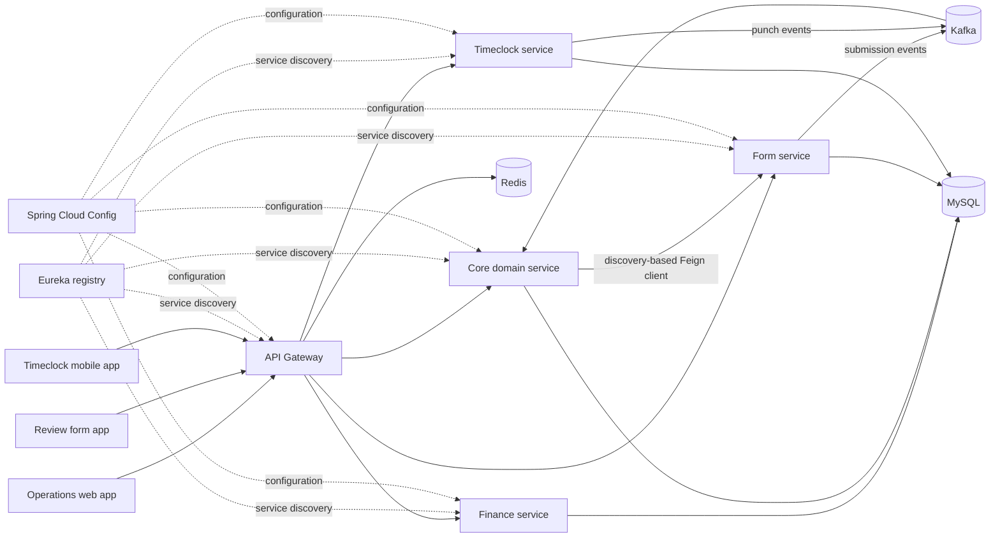

# Eventico Workforce Operations Platform

A multi-service workforce and event operations platform built around staffing, review workflows, time tracking, and finance automation. This repository contains the backend services, a web operations portal, a service-provider review application, and an Android timeclock application used by field teams.

This project is best understood as a portfolio-grade platform composed of several related systems rather than a single monolithic application. The codebase demonstrates service-oriented architecture, event-driven integration, React/Next.js frontends, and Java/Spring-based back-end services.

## Why this project exists

The platform is designed to replace fragmented manual workflows across event operations:

- job planning and service-provider assignments
- provider and client review collection
- on-site attendance tracking with a mobile clock-in/clock-out flow
- invoice intake, OCR/Document AI processing, and bank matching
- operational visibility for finance and administrators

## Core features

- Event and staffing lifecycle management in the core application
- Service-provider review forms with tokenized access and file uploads
- Timeclock punches captured through a mobile-first Android app
- Offline-first punch queue for unreliable field connectivity
- Finance automation for invoice upload, optional email ingestion, and bank movement matching
- API gateway and service discovery for internal microservice routing
- Gateway JWT validation enabled by default, with environment-driven configuration
- Observability hooks via Actuator, tracing, and standardized logging

## Screenshots

Representative screens from the operations portal. Sensitive project and customer details have been obscured.

### Operations calendar



### Finance invoice list



### Invoice creation



## Architecture overview



The diagram summarizes the configured service relationships; it is not a deployment topology or guarantee that every optional integration is enabled in a local run.

## Technology stack

### Frontend

| Layer | Technologies |
| --- | --- |
| Web app | Next.js, React, TypeScript, Tailwind CSS, Redux Toolkit, Axios |
| Review portal | Next.js, React, Tailwind, Yup, React Hook Form |
| Mobile app | Expo, React Native, SQLite, AsyncStorage, NetInfo, background sync |
| Auth | NextAuth.js in the operations app, shared HS512 JWT validation enabled by default, tokenized review links |

### Backend

| Layer | Technologies |
| --- | --- |
| Java services | Spring Boot 2.7 / 3.5, Java 8 / 17 by module, Spring MVC, Spring Data JPA |
| API gateway | Spring Cloud Gateway, Spring Security, JWT resource server |
| Service discovery | Netflix Eureka |
| Configuration | Spring Cloud Config |
| Messaging | Kafka |
| Data | MySQL, Redis, Flyway |
| Observability | Spring Actuator, Micrometer tracing, correlation IDs |
| Finance automation | Apache PDFBox, OCR/document AI, Microsoft Graph, bank import parsers |

### Gateway routing and access control

| Destination | Configured route prefixes |
| --- | --- |
| Finance | `/api/v1/invoices/**`, `/api/v1/matching/**`, `/api/v1/bank/**` |
| Forms | `/api/form/**`, `/api/v1/form/**` |
| Timeclock | `/api/timeclock/**`, `/api/users/**`, `/api/admin-config/**`, plus versioned and legacy rewrites |
| Core domain | Remaining `/api/**` paths |

These prefixes describe routing destinations; they do not mean the paths are public. With the gateway's default JWT security setting, health and API documentation endpoints plus selected token-backed workflows are permit-listed, finance routes require the `finance` or `admin` scope, and other routes require authentication. Core-issued HS512 JWTs are validated with the required shared `JWT_SIGNING_SECRET` and `JWT_AUDIENCE`; no external issuer is assumed. JWT security can be disabled with `JWT_SECURITY_ENABLED=false`; do not do so in a shared or publicly reachable environment. Gateway rate limiting is enabled by default and uses the socket peer address. Configure explicit trusted proxy IPs with `GATEWAY_RATE_LIMIT_TRUSTED_PROXIES` before relying on forwarded client addresses.

Core job access follows the existing ownership model: clients can manage their own jobs, moderators/creators can manage records assigned to them, and service providers can read assigned jobs and update their own timesheets. Cross-account job creation, offers, and user updates are rejected. Unscoped attachment endpoints remain administrator-only because filenames alone do not identify a safe owner. Public account registration accepts client and service-provider account types only; moderator/admin assignment is not self-service.

### Environment templates

- `backend/env.example` lists backend and local Compose variables. Copy it to an ignored `backend/.env.local` for local Compose use.
- Each frontend has its own `.env.example`; copy it to that app's ignored `.env`.
- These examples are placeholders, not credentials. Supply real credentials only through a local ignored file or a secret manager.
- Set a non-empty local `MYSQL_ROOT_PASSWORD` and the required JWT values before starting Compose. Templates intentionally leave these values blank.
- `FORM_CORS_ALLOWED_ORIGINS` and `FINANCE_CORS_ALLOWED_ORIGINS` accept comma-separated browser origins; their defaults allow only the corresponding local frontends.
- `EVENTICO_PUBLIC_BASE_URL` and `EVENTICO_CONTACT_EMAIL` configure outgoing email links and sender details. `INVOICE_COMPANY_*`, `INVOICE_SUBMISSION_EMAIL`, and `INVOICE_RECIPIENT_DETAILS` customize invoice PDF contact/payment details and use demo placeholders by default.
- Twilio SMS is disabled unless `TWILIO_ENABLED=true` and valid account, sender, and recipient settings are provided. Do not enable it against real recipients during local testing.

## Repository structure

```text
.
├── .github/                    # backend CI and security scanning workflows
├── .env.example                # root reference for local variables
├── .gitignore                  # repository hygiene rules
├── LICENSE                     # all-rights-reserved terms
├── README.md                   # platform overview and setup guide
├── SECURITY.md                 # vulnerability reporting guidance
├── backend/
│   ├── api-gateway/             # routing, default-on JWT validation, filters
│   ├── config-server/           # centralized Spring configuration
│   ├── contract-tests/          # contract-test definitions and guidance
│   ├── core-service/            # core operational domain
│   ├── deploy/                  # local Compose and Kubernetes/Helm examples
│   ├── docs/                    # operational and API policies
│   ├── finance/                 # invoice ingestion, parsing, matching
│   ├── form-service/            # review form intake
│   ├── service-registry/        # Eureka service discovery
│   ├── timeclock/               # attendance and punch service
│   ├── env.example              # backend local environment template
│   └── MICROSERVICE-BOOTSTRAP.md
├── frontend/
│   ├── eventico-timeclock-mobile/ # Expo / React Native timeclock app
│   ├── rentman-main/              # operations web app
│   └── review-form-app/           # provider review frontend
```

## Main application modules

### 1. Core domain (`backend/core-service`)

This is the main application service for the operational domain. It contains the user, job, billing, and event-management logic that ties the wider platform together.

### 2. Form service (`backend/form-service`)

The form service accepts details and files for service-provider submissions and emits events for downstream processing. It supports multipart uploads and review-based workflows.

### 3. Timeclock service (`backend/timeclock`)

The timeclock service handles attendance and punch logic, with MySQL persistence, Kafka message flow, and device-project linkage. It is a clear example of event-driven operational integration.

### 4. Finance service (`backend/finance`)

This service automates invoice ingestion and matching. It supports:

- invoice upload and metadata extraction
- optional Microsoft Graph email fetch for invoice attachments
- document parsing and OCR fallbacks
- bank statement import parsing
- matching logic based on amount, reference, and company data

### 5. Gateway and infrastructure

The repo includes an edge gateway, config server, and Eureka registry to support service discovery and central routing.

- `api-gateway`: routes traffic for finance, form, timeclock, and core operations; JWT validation and rate limiting default on
- `config-server`: central config provider
- `service-registry`: service discovery and health registration

## Workflows and business logic

### Job planning and staffing

The operations portal manages event/job details, staffing decisions, and follow-up flows. The UI and core backend coordinate assignments and provider/review records.

### Review submission flow

A provider or client receives a tokenized review link from the main platform. The review form app submits responses and attachments to the review backend service, which persists data and publishes events for downstream processing.

### Timeclock and field attendance

The mobile app allows field teams to clock in and out even in poor connectivity scenarios. Punches are persisted locally in SQLite and synced later using retry and queue patterns. PINs are validated by a dedicated request that returns a short-lived, device-bound timeclock token; directory responses never include PINs. A user must have validated their PIN on that device while online at least once before offline PIN recognition is available. Administrators use their existing core account credentials for device-link changes; there is no shared admin code.

### Finance workflow

The finance stack extracts invoice data, can read email attachments through Microsoft Graph when configured, imports bank statements, and applies matching heuristics to reconcile ledger entries.

Kafka listeners retry processing failures three times and then publish to the corresponding `<topic>.DLT`; provision those DLT topics in the broker configuration. The transactional outbox waits for broker acknowledgement before marking an event published.

## Database and integration overview

The services configure their own MySQL database schemas and persistence. The local Compose example uses a single MySQL container with separate databases; this is a development convenience, not a claim about production database isolation.

- MySQL for service data and operational persistence, with Flyway migration locations in selected services
- Redis for gateway rate limiting
- Kafka for asynchronous event propagation between services
- Spring Data JPA and Flyway for persistence and schema handling

## Authentication and security approach

The codebase demonstrates a layered security strategy that is still evolving toward a more production-hardened standard:

- the API gateway and finance service validate core-issued HS512 JWTs using a required shared signing secret and audience; gateway JWT enforcement defaults on
- finance APIs require the `finance` or `admin` OAuth2 scope
- core-service operations require authentication; public review and job-acceptance actions use expiring signed tokens
- core, form, gateway, finance, and timeclock services must share `JWT_SIGNING_SECRET`, supplied as Base64 encoding of at least 64 random bytes; set `JWT_AUDIENCE` to the exact audience used by the runtime tokens
- signing keys and identity-provider settings must be injected through a secret manager or protected runtime environment; never commit them

The deployment examples require an externally supplied signing secret and an explicitly configured `JWT_AUDIENCE`; the audience value is application-specific configuration, not an identity-provider URL. Rotate any previously exposed signing key before deployment. Review scopes, network exposure, secret handling, and operational controls before using the system with real data.

## Local setup

### Prerequisites

- Docker Desktop with Docker Compose v2 for the local backend stack
- Node.js and npm; pnpm via Corepack for `rentman-main`
- Java 21 for Maven builds (the legacy core/form modules target Java 8 bytecode)

### 1. Configure local environment

The committed `.env.example` files are templates, not credentials. Spring Boot does not load a `.env` file by itself. For Docker Compose, copy the backend template to an ignored local file and set a local `MYSQL_ROOT_PASSWORD`, choose the required `JWT_AUDIENCE`, and provide a Base64-encoded random `JWT_SIGNING_SECRET` shared by the services:

```powershell
Copy-Item backend\env.example backend\.env.local
notepad backend\.env.local
```

Do not commit `.env.local` or real credentials. Generate the signing key outside the repository (for example, `openssl rand -base64 64`) and inject it only through the ignored local environment or a secret manager. Optional integrations such as Microsoft Graph, Twilio, and Document AI are disabled or unconfigured unless you explicitly supply credentials.

### 2. Start the backend stack with Docker Compose

From `backend/deploy`:

```powershell
docker compose --env-file ..\.env.local -f docker-compose.microservices.yml up --build
```

The Compose stack builds the Java services from the shared `backend/deploy/Dockerfile.java-service`, starts local infrastructure, and creates per-service MySQL databases on first initialization. Treat it as development-only; it is not a production security configuration. The MySQL init script runs only when the database volume is first created.

For service startup order and route details, see `backend/MICROSERVICE-BOOTSTRAP.md`.

### 3. Start the web and review apps

From the repository root:

```powershell
# Terminal 1
Set-Location frontend\rentman-main
Copy-Item .env.example .env
corepack pnpm install
corepack pnpm dev

# Terminal 2, from the repository root
Set-Location frontend\review-form-app
Copy-Item .env.example .env
npm ci
npm run dev
```

Open each app in a separate terminal. Both apps expect their own ignored `.env` file; copy the adjacent `.env.example` and set a random local `NEXTAUTH_SECRET`.

### 4. Start the mobile app

```powershell
Set-Location frontend\eventico-timeclock-mobile
Copy-Item .env.example .env
npm ci
npx expo start
```

## Build and deployment notes

The repository contains Java Maven projects and frontend apps that can be built individually:

```powershell
Set-Location backend\api-gateway
.\mvnw.cmd -B -DskipTests package

Set-Location ..\finance
.\mvnw.cmd -B -DskipTests package

Set-Location ..\timeclock
.\mvnw.cmd -B -DskipTests package

Set-Location ..\..\frontend\review-form-app
npm run build

Set-Location ..\rentman-main
corepack pnpm build
```

There is no root Node workspace: install dependencies from each frontend app directory using its own lockfile (`npm ci` for the two npm apps, `corepack pnpm install --frozen-lockfile` for `rentman-main`). Commit those app-level lockfiles, but never commit `node_modules`, Maven `target`, or generated frontend/Android build output; the root `.gitignore` excludes these. The mobile app has lint and test scripts but no generic production `build` script; use the appropriate Expo/EAS workflow if you need a distributable.

Deployment assets also exist under `backend/deploy/` for Docker and Helm-based deployment references, although the repo should be treated as a collection of application modules with separate runtime configurations rather than one single deployment artifact.

Local files under service `src/main/resources/uploads/` directories are excluded from Git/Docker contexts and from the Maven artifacts. Runtime uploads are read from the configured upload directory; they are not application fixtures or distributable assets.

The backend CI workflow builds Java modules with tests skipped, then runs the form, timeclock, and finance controller contract tests separately. The YAML files under `backend/contract-tests/contracts/` are scaffolding and are not executed by CI. The frontend CI workflow runs lint/build checks for the web and mobile applications. The timeclock application context test currently requires MySQL and does not pass in a clean local environment without a database.

## Security and public-readiness guidance

Before publishing, verify that all files and Git history are authorized for public release and contain no secrets, customer data, or private infrastructure details. Ignoring a file does not remove a copy already tracked or committed. See [SECURITY.md](SECURITY.md) for reporting guidance.

## Notable engineering implementation patterns

- event-driven integration between backend services
- offline-first mobile sync pattern for disrupted field connectivity
- API gateway-based route control with configurable edge security
- mixed legacy and modern stack evolution (Spring Boot 2.7 and 3.x)
- finance automation with OCR + Document AI fallback logic
- tokenized public review links that reduce direct app session coupling

## License

Copyright (c) 2026 Usama Ghori. All rights reserved. This repository is available for portfolio viewing and evaluation; no permission is granted to copy, modify, distribute, or use the code without prior written permission. See [LICENSE](LICENSE).
